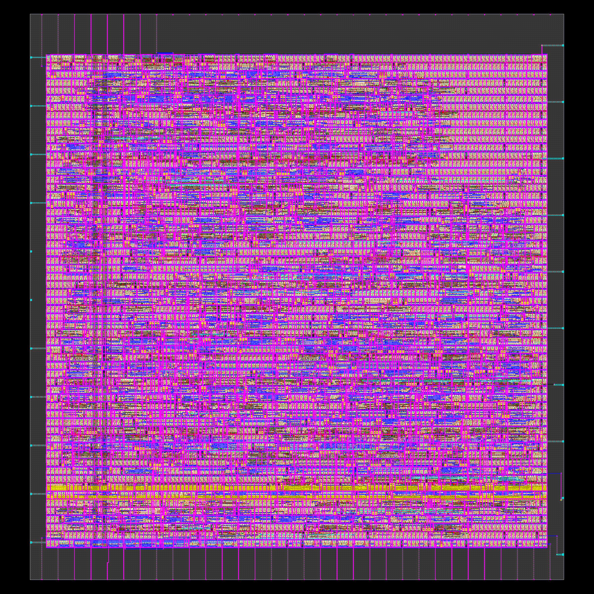
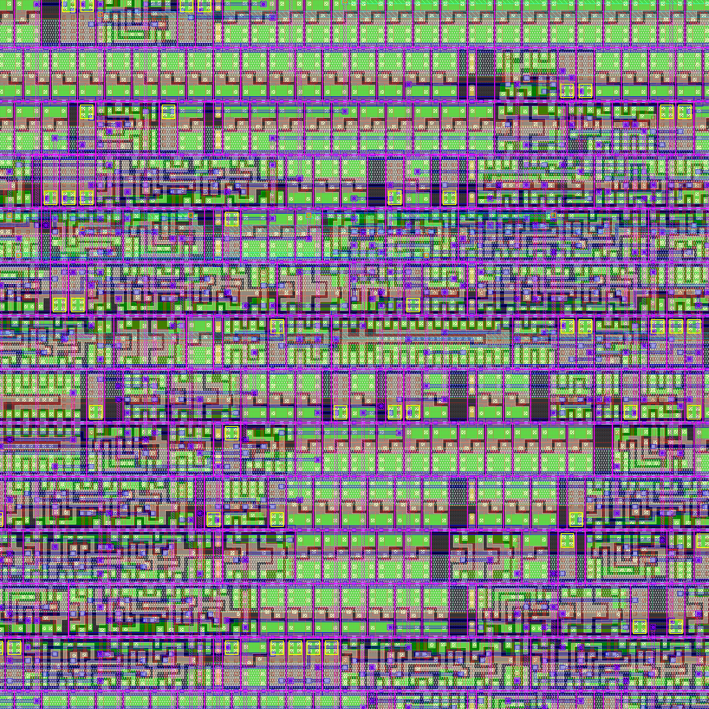

# SPI RTL to GDS Flow

<p align="center"></p>

An APB3 SPI master controller taken through a full ASIC design flow: RTL design, UVM verification with SystemVerilog assertions and code and functional coverage, and RTL-to-GDSII physical design on the SkyWater **SKY130** 130 nm open PDK with OpenLane 2 (LibreLane).

---

## Highlights

| Area | Result |
|------|--------|
| UVM regression | **10 / 10 tests pass**, 0 scoreboard mismatches, 0 assertion failures |
| Functional coverage (merged) | **99.80 %** (7 covergroups) |
| Code coverage (DUT) | statement **100 %**, branch **95–100 %**, condition **93–100 %** |
| Toggle coverage (ports + key registers) | **109 / 109 bits (100 %)** |
| Assertions | 35+ SVA properties + 9 cover properties |
| Technology | SKY130A, `sky130_fd_sc_hd` |
| Signoff | **50 MHz**, timing met in **all 9 PVT/RC corners** (setup WNS +2.57 ns, hold WNS +0.11 ns) |
| Area / power | 0.034 mm² die, 793 cells (219 flip-flops), 1.68 mW |
| Physical verification | DRC **0**, LVS **clean**, antenna **0** |

---

## SPI master features

* AMBA **APB3** slave interface, zero wait state, `PSLVERR` on unmapped addresses (0x20–0x3C)
* All four **SPI modes** (CPOL / CPHA), **MSB- or LSB-first**, 8-bit frames
* Programmable clock: `SCLK = PCLK / (2 × (CLKDIV + 1))`
* 8-deep **TX and RX FIFOs**; back-to-back bytes under one chip-select frame
* Half-SCLK chip-select setup and hold time
* **4 chip selects** with **automatic** (per burst) or **manual** (software) control
* Interrupts: RX available, TX empty, transfer **done**, **RX overrun**, **TX overflow** (sticky ones are write-1-to-clear)
* Internal **loopback** (MOSI → MISO, no slave selected)

### Register map

| Offset | Name | Access | Description |
|-------:|------|:------:|-------------|
| 0x00 | TXDATA | W | Push byte into TX FIFO |
| 0x04 | RXDATA | R | Pop byte from RX FIFO (reads 0 when empty) |
| 0x08 | CTRL | RW | [0] EN [1] CPOL [2] CPHA [3] LSB_FIRST [4] LOOPBACK [5] CS_MANUAL |
| 0x0C | CLKDIV | RW | [7:0] clock divider (reset 4) |
| 0x10 | STATUS | R | [0] TX_FULL [1] TX_EMPTY [2] RX_FULL [3] RX_EMPTY [4] BUSY [11:8] TX_LVL [19:16] RX_LVL |
| 0x14 | IER | RW | Interrupt enables (same bit order as ISR) |
| 0x18 | ISR | R/W1C | [0] RX_AVAIL [1] TX_EMPTY [2] DONE [3] RX_OVERRUN [4] TX_OVERFLOW |
| 0x1C | CSREG | RW | [1:0] CS_SEL [2] CS_ASSERT (manual mode) |

### Block diagram

```
            +------------------------------ spi_top -------------------------------+
  APB3 ---->| spi_regs --push--> [ TX FIFO 8x8 ] --pop--> spi_master ---> sclk, mosi | 
            | (CTRL/CLKDIV/                                  |   ^                    |
            |  CSREG/IER/ISR)<--pop-- [ RX FIFO 8x8 ] <------+   +--- loopback mux <--| miso
  irq <-----|  irq = |(ISR & IER)              CS decode (auto / manual) ----------> | ss_n[3:0]
            +----------------------------------------------------------------------+
```

---

## Repository structure

```
spi-rtl-to-gds-flow/
├── rtl/                  spi_top, spi_regs, spi_master, spi_fifo (Verilog)
├── verif/
│   ├── tb/               tb_top, APB and SPI interfaces
│   ├── uvm/              UVM package: APB agent, SPI slave agent, scoreboard, coverage, sequences, tests
│   └── sva/              assertion module, toggle-coverage monitor, bind file
├── sim/                  xsim regression script and file lists
├── openlane/             OpenLane 2 config, SDC, pin order, layout render script
├── gds/                  final GDSII, LEF, DEF
├── netlist/              gate-level netlists and SPEF
├── reports/
│   ├── verification/     regression summary, test logs, code + functional coverage (HTML)
│   └── asic/             metrics, flow log, synthesis / DRC / LVS / antenna reports
├── docs/                 project report (PDF) and layout images
└── .github/workflows/    RTL-to-GDS flow on GitHub Actions
```

---

## Verification

### UVM environment

```
uvm_test_top
└── env (spi_env)
    ├── apb_agt (apb_agent)   APB3 master driver, monitor, sequencer
    ├── spi_agt (spi_agent)   reactive SPI slave model (driver) + bus monitor
    ├── sb  (spi_scoreboard)  MOSI / MISO / loopback data paths, chip-select index,
    │                         overflow and overrun model, sticky ISR model, register mirrors
    └── cov (spi_coverage)    7 covergroups
```

* **Slave model:** returns a random byte per transfer and follows the live CPHA and bit order, updating MISO on the shift edge.
* **Monitor:** samples MOSI and MISO on the CPHA-selected edges for the active chip select and flags more than one active select.
* **Assertions:** APB protocol and PSLVERR decoding, FIFO integrity, SCLK at the CPOL idle level, SCLK toggling only during a transfer, chip select held for every transfer, one-hot / correctly decoded `ss_n`, no slave selected in loopback, exactly 16 SCLK edges per byte, DONE pulse semantics, overrun / overflow / done flag setting, W1C-only clearing, `irq == |(ISR & IER)`, reset values.
* **Functional coverage:** SPI mode × bit order, mode × chip select, mode × back-to-back, MOSI/MISO data corners, clock-divider ranges, register access cross, ISR × IER, FIFO levels, operating-mode cross.

### Tests and results

| Test | Scenario | Result |
|------|----------|:------:|
| `spi_smoke_test` | mode 0 basic transfers | PASS |
| `spi_reg_test` | reset values, R/W patterns, RO registers, PSLVERR on 8 unmapped addresses | PASS |
| `spi_mode_test` | all 4 modes × MSB/LSB, random divider / chip select | PASS |
| `spi_clkdiv_test` | CLKDIV 0 … 255 | PASS |
| `spi_cs_test` | each chip select, automatic and manual frames | PASS |
| `spi_overflow_test` | 11 writes into an 8-deep TX FIFO | PASS |
| `spi_overrun_test` | 11 received bytes into an 8-deep RX FIFO | PASS |
| `spi_loopback_test` | internal loopback, random modes | PASS |
| `spi_irq_test` | each interrupt source: set, mask, clear | PASS |
| `spi_random_test` | constrained-random mix incl. manual CS frames | PASS |

| Covergroup | Score |  | Module | Stmt | Branch | Cond |
|------------|------:|--|--------|-----:|-------:|-----:|
| cg_xfer | 100 % | | spi_regs | 100 % | 100 % | 100 % |
| cg_data | 100 % | | spi_master | 100 % | 95 % | 100 % |
| cg_div | 100 % | | spi_fifo (x2) | 100 % | 100 % | 92.86 % |
| cg_apb | 98.61 % | | spi_top | n/a | 100 % | n/a |
| cg_isr, cg_status, cg_ctrl | 100 % | | | | | |
| **Total** | **99.80 %** | | **Toggle** | | | **109/109** |

Run the regression with Vivado 2024.2:

```bash
cd sim
./run_regression.sh
```

---

## RTL-to-GDS (SKY130, OpenLane 2)

Flow: Yosys synthesis → floorplan and PDN → placement → CTS → routing → RC extraction → multi-corner STA → Magic and KLayout DRC → Netgen LVS → antenna check → GDSII, run by `.github/workflows/rtl2gds.yml`.

| Metric | Value |
|--------|------:|
| Clock | 50 MHz (20 ns), 30 % I/O budgets |
| Setup WNS / TNS (worst of 9 corners) | **+2.57 ns** / 0 |
| Hold WNS (worst of 9 corners) | **+0.11 ns** |
| Setup WNS ss_100C_1v60 / tt_025C_1v80 / ff_n40C_1v95 | +2.65 / +5.13 / +6.24 ns |
| Clock skew (worst) | 0.27 ns |
| Die size | 179.7 × 190.4 µm (0.034 mm²) |
| Std-cell area / utilization | 16,929 µm² / 60.6 % |
| Synthesized cells / flip-flops | 793 / 219 |
| Total power (tt) | 1.68 mW (internal 1.07, switching 0.61) |
| Routed wirelength | 33,037 µm |
| I/O pins | 87 |
| Magic DRC / KLayout DRC / route DRC | 0 / 0 / 0 |
| LVS | clean |
| Antenna violations | 0 |

Timing is met in every PVT/RC corner. Max-slew and max-capacitance warnings are reported by OpenSTA on a few nets in some corners, mostly slow-slow; they are listed in `reports/asic/warning.log`.

<p align="center">
  
  
</p>

To run the flow locally with Docker:

```bash
pip install librelane
librelane --dockerized openlane/config.json
```

## Tools

| Stage | Tool |
|-------|------|
| RTL simulation, UVM 1.2, SVA, coverage | AMD Vivado 2024.2 XSIM / XCRG |
| Synthesis | Yosys |
| Floorplan, placement, CTS, routing, STA | OpenROAD / OpenSTA (OpenLane 2 / LibreLane) |
| DRC / LVS / GDS | Magic, KLayout, Netgen |
| PDK | SkyWater SKY130A |

---

## 👨‍💻 Author
**M Kamaraju**
📬 [LinkedIn](https://www.linkedin.com/in/magupallikamaraju/)
📧 [mnithen79@gmail.com](mailto:mnithen79@gmail.com)

If you use or build on this project, please give credit by linking back to this repository.

## 📄 License
This project is licensed under the MIT License. See [LICENSE](LICENSE) for full details.
